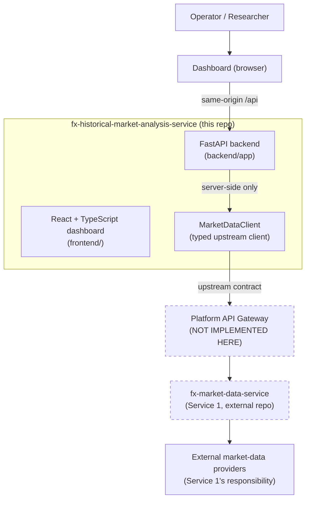

# Architecture

## 1. Purpose

`fx-historical-market-analysis-service` (Service 2) is the second microservice
in the Forex AI platform. Its eventual responsibility is to analyse historical
foreign-exchange market observations in order to discover statistically
defensible historical patterns, market regimes, temporal relationships, and
other evidence-supported findings.

**This repository is the foundation phase.** The historical analysis engine is
**not implemented**. See [Current capabilities](#6-current-capabilities) and
[Deferred capabilities](#7-deferred-capabilities).

---

## 2. System context



### Boundary rules

| Rule | Enforcement |
| --- | --- |
| The browser never calls Service 1 | The dashboard only knows `VITE_API_BASE_URL`, which points at this service's own backend. `frontend/nginx.conf` proxies only `/api/` to `backend:8000`. |
| This service never integrates a provider | There is no provider SDK, provider credential, or feed code in this repository. |
| This service never re-validates market data | The upstream client validates *shape* only. Coverage and validation metadata come from Service 1. |
| No gateway is implemented here | Only the outbound client boundary and the documentation of the expected contract exist. |

---

## 3. Repository layout

```text
fx-historical-market-analysis-service/
├── backend/
│   ├── app/
│   │   ├── api/v1/            # Versioned routing
│   │   │   ├── router.py      # Aggregates the v1 routers
│   │   │   └── routes/        # health.py, status.py, version.py
│   │   ├── core/              # config.py, errors.py, logging.py
│   │   ├── middleware/        # auth, correlation, request_logging, security
│   │   ├── schemas/           # Request/response contracts (incl. upstream.py)
│   │   ├── clients/           # market_data.py: typed upstream client
│   │   ├── services/          # health_service.py: operational truth
│   │   ├── observability/     # metrics.py, tracing.py
│   │   └── main.py            # create_app() factory + entrypoint
│   │                          (no repositories/ package: nothing is persisted)
│   ├── tests/
│   │   ├── unit/              # config, correlation, errors, upstream client
│   │   ├── integration/       # HTTP contract behaviour
│   │   ├── contract/          # Upstream payload shapes + labelled fixtures
│   │   └── security/          # auth, headers, size limits, trusted hosts
│   ├── pyproject.toml
│   └── Dockerfile
├── frontend/
│   ├── src/
│   │   ├── app/               # App shell, data hook, styles
│   │   ├── components/        # Reusable presentation components
│   │   ├── features/          # Overview, Workspace, Integration, Diagnostics
│   │   ├── schemas/           # Zod runtime validation schemas
│   │   ├── services/api/      # Typed API client
│   │   └── tests/             # Vitest suites
│   ├── package.json
│   └── Dockerfile
├── contracts/
│   └── upstream-market-data-contract.md   # VERIFIED + unverified sections
├── docs/                      # This file, api, security, dev, deployment, audit
├── .github/workflows/ci.yml
├── compose.yaml
├── .env.example
└── README.md
```

Every module exists for a stated purpose. There are no placeholder modules.

---

## 4. Backend module responsibilities

| Module | Responsibility | Does NOT |
| --- | --- | --- |
| `core/config.py` | Validate environment configuration; fail fast on unsafe production settings. | Read secrets from files. |
| `core/errors.py` | Normalise every failure into one error envelope with a stable code. | Leak exception internals. |
| `core/logging.py` | Emit structured JSON logs with the correlation ID attached. | Log credentials or query strings. |
| `middleware/correlation.py` | Sanitise and propagate `X-Request-ID` / `X-Correlation-ID`. | Trust an unbounded client-supplied ID. |
| `middleware/auth.py` | Enforce the inbound API key on non-public paths. | Log or echo the presented key. |
| `middleware/security.py` | Security headers and request body size limits. | Be disabled in production. |
| `schemas/upstream.py` | Typed mirror of the Service 1 payload shapes. | Re-interpret market data semantics. |
| `clients/market_data.py` | Server-side calls to Service 1 with timeouts, correlation propagation, and sanitised errors. | Be called from the browser. |
| `services/health_service.py` | The single source of truth for operational state. | Report a state it has not observed. |
| `observability/metrics.py` | Prometheus-compatible metrics on a dedicated registry. | Expose default process metrics. |
| `observability/tracing.py` | Optional OpenTelemetry instrumentation. | Prevent startup when the collector is down. |
| `main.py` | `create_app()` factory: wiring, middleware order, exception handlers. | Contain business logic. |

### Middleware order

Starlette runs the most recently added middleware first, so the registration
order in `main.py` yields this request flow:

```text
SecurityHeaders -> RequestLogging -> RequestSizeLimit -> TrustedHost
-> CORS -> CorrelationID -> Auth -> routes
```

Correlation ID runs inside auth so that a 401 response still carries a
correlation ID.

---

## 5. Frontend module responsibilities

| Module | Responsibility |
| --- | --- |
| `app/App.tsx` | Shell, layout, and the read-only framing of the dashboard. |
| `app/useServiceStatus.ts` | Loads status, readiness, and version independently so one failure does not hide the others. |
| `components/` | Reusable presentation: badges, panels, loading, empty, error states. |
| `features/ServiceOverview.tsx` | Service identity, version, connectivity, readiness. |
| `features/AnalysisWorkspace.tsx` | The reserved workspace; states that the engine is not implemented. |
| `features/DataSourceIntegration.tsx` | Upstream identity and the real connection state. |
| `features/OperationalDiagnostics.tsx` | Safe diagnostics, correlation IDs, refresh time. |
| `schemas/api.ts` | Zod schemas mirroring the backend contracts. |
| `services/api/client.ts` | Typed client: timeout, runtime validation, normalised errors. |

---

## 6. Current capabilities

Implemented in this phase:

- Application factory with validated configuration and safe production invariants.
- Versioned API routing under `/api/v1`.
- `GET /api/v1/health/live`, `/ready`, `/status`, `/version`.
- Prometheus metrics at `/metrics`.
- Structured JSON logging, OpenTelemetry tracing (opt-in).
- Consistent error envelopes and request correlation IDs.
- A typed, read-only upstream client with the verified Service 1 contract.
- A dedicated React/TypeScript dashboard with validated loading, empty,
  unavailable, and error states.

## 7. Deferred capabilities

**Deliberately not implemented in this phase:**

- historical statistics and descriptive measures,
- pattern and relationship discovery,
- market regime and volatility characterisation,
- statistical strength and limitation evaluation,
- reproducible analytical results with provenance,
- any persistence of analytical results.

The `status` endpoint reports each of these with `implemented: false`, and the
dashboard renders them as deferred. No endpoint returns fabricated analytical
results.

---

## 8. Gateway integration

**PROPOSED — NOT YET VERIFIED.** No gateway repository, configuration, or route
table was found in either the Service 1 repo
table was found in either the Service 1 repository or this one, so no gateway
route is invented here.

The design keeps the gateway concern at the edge:

- This service mounts its own API at `/api/v1` and can be reached directly.
- The upstream base URL is configurable, so the same build can point at a
  gateway route or at Service 1 directly.
- Internal modules contain **no** gateway-specific routing; only the client
  knows how to reach the upstream.
- Correlation and trace propagation use the platform conventions verified in
  Service 1 (`X-Request-ID` / `X-Correlation-ID`).
- The dashboard's own path to the backend may terminate at the gateway, but
  the gateway never proxies to Service 1 on the browser's behalf.

---

## 9. Persistence

No database is provisioned. Nothing in this phase stores analytical results,
and Service 1 remains the owner of the source data. `DATABASE_URL` exists in
the configuration only so that a later, separately justified phase can add
persistence without changing the configuration shape. See
`docs/acceptance-audit.md` for the justification required before that phase.
